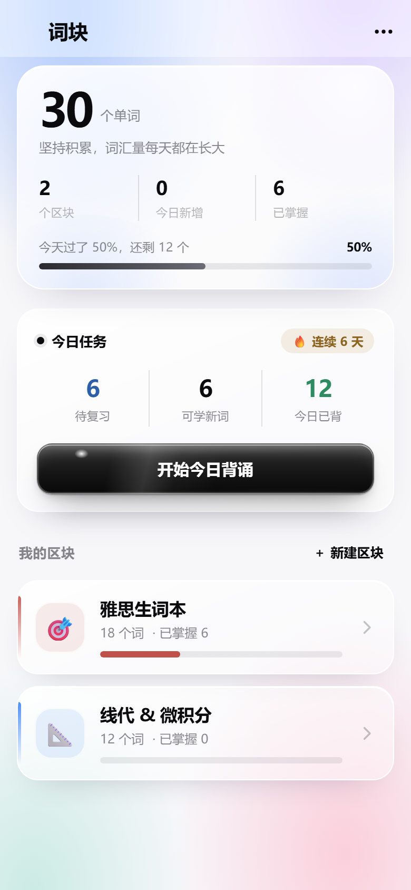
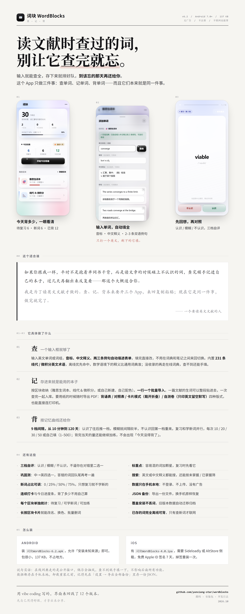

# 词块 WordBlocks

> 读文章时查过的词，别让它查完就忘。

一个只做三件事的 Android 背词工具：**查单词、记单词、背单词**。
不是从「今天背 50 个」开始，而是从「这篇文章里我不会的词」开始。

| | |
|---|---|
| 最新版 | 6.2（versionCode 12） |
| 安装包 | `release/词块WordBlocks-6.2.apk` · 137 KB |
| 系统 | Android 7.0 及以上（minSdk 24 / targetSdk 34） |
| iOS | `release/词块WordBlocks-4.0.ipa`（侧载安装，见下文） |
| 数据 | 全部存在手机本地，不登录、不上传、无广告 |



---

## 这个适合谁

如果你跟我一样，平时不是抱着单词书干背，而是**读文章时碰上不认识的词，查完顺手记进自己的本子，过几天再翻出来反复看**——那这个大概适合你。

这个项目是为了读英文文献做的。查、记、背本来要开三个 App，来回复制粘贴；现在是同一件事，做完就完了。

## 三个核心

**01 查**　输入英文单词或词组，音标、中文释义、两三条例句自动填进表单，填完直接改。内置 231 条线代 / 微积分英文术语，离线优先命中，数学语境下的释义比通用词典准；没收录的再走在线词典，查不到还能手填。

**02 记**　按区块收纳（雅思生词本、线代 & 微积分，或自己新建、自己配色）。一行一个批量导入，一篇文献的生词可以整段贴进去，一次查完一起入库。要用纸的时候导出 PDF：背诵表 / 对照表 / 卡片模式（裁开折叠）/ 自测卷（只印英文留空默写）四种版式。

**03 背**　9 档记忆曲线，间隔 10 分钟 → 1 / 2 / 4 / 7 / 15 / 30 / 60 / 120 天：认识了往后推一档，模糊就间隔砍半，不认识回第一档重来。复习和学新词并行，每次 10 / 20 / 30 / 50 或自己填（1–500）；背完当天的量还能继续加练。

## 完整功能

- **三档自评**：认识 / 模糊 / 不认识，不逼你在对错里二选一
- **巩固测**：中→英四选一，答错的词回队尾再考一遍（同词最多 3 次，防死循环）
- **新词占比可调**：0 / 25% / 50% / 75%，只想复习就不学新的
- **连续打卡**与今日进度条，背了多少不用自己算
- **每个区块单独统计**：待复习 / 可学新词 / 可加练
- **长按区块卡片**就能改名、换色、批量删词
- **标重点**：容易混的词加颗星，复习时先看它
- **搜索**：英文或中文释义都能搜，还能按未掌握 / 已掌握筛
- **数据只在手机本地**：不登录、不上传、没有广告
- **JSON 备份**：导出一份文件，换手机原样恢复
- **覆盖安装不丢词**：旧版本数据自动迁移归档，升级不用手动搬
- **已存的词完全离线可背**，只有查新词才联网

## 装到手机上

**Android**：把 `release/词块WordBlocks-6.2.apk` 传到手机，允许「安装未知来源」→ 安装。包只有 137 KB，不占地方。

**iOS**：`release/词块WordBlocks-4.0.ipa` 是 arm64 / iOS 14+ 的未签名包，用 Sideloadly 或 AltStore 侧载，免费 Apple ID 签名 7 天，掉签重装一次即可。

> 数据都存在手机本地（`/data/data/com.wordblocks.app/files/wordblocks.json`）。
> 卸载重装之前，记得先在「设置 → 导出全部备份」里存一份 JSON。

## 仓库结构

```
.
├── release/                 各个版本的安装包（1.0 / 3.1 / 4.0 / 6.2 + iOS 4.0）
├── src/
│   ├── assets/              前端全部源码：index.html / app.js / app.css / glossary.js
│   └── res/                 应用图标（自适应图标与各密度切图）
├── docs/
│   ├── 工作日志-2026-10-15.md
│   ├── 工作日志-2026-10-19.md
│   ├── 工作日志-2026-10-20.md
│   ├── 项目记忆-版本演进-2026-10-19.md
│   └── 词块4.0-使用说明.pdf
├── poster/
│   ├── 词块-宣传海报.png     长图海报（2480 × 6187）
│   ├── poster.html          海报源文件（改完用浏览器截图即可重出图）
│   └── shots/               应用界面截图
└── README.md
```

## 想直接看界面

`src/assets` 是纯前端，不依赖安卓就能跑：进目录起个静态服务再打开即可。

```bash
cd src/assets
python -m http.server 8080
# 浏览器打开 http://127.0.0.1:8080
```

没有 `Android` 桥时，`app.js` 会自动降级成 `localStorage` 存数据、`window.print()` 导出，功能基本完整，适合改样式时预览。

## 技术实现

原生壳（WebView）+ 前端 HTML/CSS/JS，原生只做四件事：

1. **持久化**：`getFilesDir()/wordblocks.json` 读写，JS 侧同步走 `Android.loadData()` / `saveData()`
2. **词典请求**：有道 `dict.youdao.com/jsonapi`（绕开 CORS）+ MyMemory 兜底，解析在 `Dict.java`
3. **导出 PDF**：`PrintManager` + `webView.createPrintDocumentAdapter()`，离屏 WebView 300dpi / A4 / 无边距，页边距由 CSS `@page` 控制
4. **备份导入导出**：SAF 选文件

构建不用 Gradle，`aapt2 → javac → d8 → zipalign → apksigner` 手动串起来，签名证书沿用同一个 keystore 才能覆盖安装。细节见 `src/README.md` 与 `docs/`。

## 版本演进

| 版本 | 主要变化 |
|---|---|
| 1.0 | 区块式生词本、输入自动补释义例句、导出 PDF 打印 |
| 2.0 | 记忆曲线 SRS、复习与学新词并行、旧数据迁移 |
| 2.1 | 加练兜底（背完还能背）、自定义词数、新旧新词混排 |
| 3.0 / 3.1 | 界面重做、转场动画、手绘插画、今日进度条 |
| 4.0 | 去掉循环动画、新增 iOS 版 |
| 5.0 – 5.2 | Apple 黑灰 + 毛玻璃 + 降饱和（WCAG AA） |
| 6.0 – 6.2 | 浅色玻璃体系、黑玻璃按键、面板虚化、卡顿优化、顶栏缩窄 |

完整改动记录（含每次踩的坑）在 `docs/` 里，是从项目记忆里原样导出的。

## 已知限制

- 在线词典走的是公开接口，偶尔抽风。查不到就手填，不影响背诵与导出。
- iOS 包是未签名 ipa，必须侧载，免费签名 7 天会掉。
- 没有云同步。换手机请走「导出备份 → 新机导入」。
- 前端源码是从发布版 APK 里解包还原的（`assets/` 原样取出），原生壳的 Java 源码不在仓库里，四件事的职责写在上面，重建不难。

## 海报



---

用 vibe coding 写的，界面来回改了 12 个版本。先自己用得舒服，才拿出来分享。
